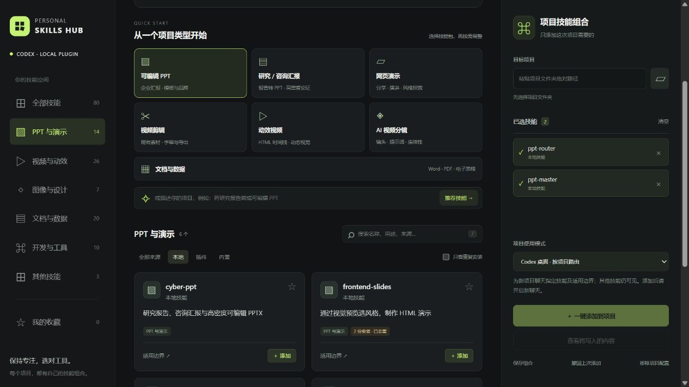

# Personal Skills Hub

**Choose the right Codex skills for each project.**

[简体中文](README.md) · [Sharing guide](SHARING.md) · [Changelog](CHANGELOG.md) · [Contributing](CONTRIBUTING.md)

A local Codex plugin and Chinese-language management panel for browsing installed skills, understanding overlapping workflows, and selecting a project-specific combination.



## Features

- Discover local skills and skills in plugin caches, grouping local duplicates while keeping plugin sources distinct.
- Search by purpose, inspect boundaries, and start from seven curated bundles.
- Detect maintained workflow conflicts and include required companion skills.
- Preview project changes, apply a selection, undo it, or detach Hub-managed blocks.
- Use the plugin from Codex or open the local management panel.

No third-party runtime npm dependencies. The web server listens on `127.0.0.1` only.

## Install

Requires Node.js 22+. Plugin installation also requires Codex and a CLI supporting `codex plugin`.

Download and extract the project, then run:

```sh
node src/install.mjs --check
node src/install.mjs
```

On Windows, you can instead run `Install Codex Plugin.cmd`. Restart Codex and find **Personal Skills Hub** in Plugins. Use **Try now** or ask Codex to open Personal Skills Hub for the current project.

To run the panel directly: `npm start`. If the default port is occupied, run `node src/cli.mjs serve --open --port 0`. Favorites and saved combinations use browser storage for the current panel origin; different ports have separate storage.

### GitHub marketplace

Install the plugin from this repository:

```sh
codex plugin marketplace add AndyMaa/personal-skills-hub
codex plugin add personal-skills-hub@personal-skills-hub
```

The local installer uses a separate `personal-skills-hub-local` marketplace. Choose one installation source.

## Project modes

| Mode | Behavior |
| --- | --- |
| Desktop routing, default | Adds selected skills and boundaries to project instructions. Other skills remain visible. Start a new project chat after applying. |
| Focused CLI | Generates a launcher that passes per-session skill overrides to Codex CLI. The restriction applies only to sessions started with that launcher. |

Desktop routing is not skill isolation. In the tested Codex `0.166.0-alpha.5.1` client, project `skills.config` was readable but did not filter the effective skill list; session `-c skills.config=...` overrides did. See [validation notes](VALIDATION.md).

Hub manages blocks in `AGENTS.md` and `.codex/config.toml`, plus project state under `.personal-skills-hub/`. It preserves unrelated content and the original skill files. Undo refuses to overwrite subsequent edits. Project manifests contain machine-local paths; re-scan and apply on another machine.

## Scope

Hub scans the user's `.agents/skills`, `.codex/skills`, and Codex plugin cache, following `CODEX_HOME` when set. A cached skill does not prove that its connector is installed or authorized. Recommendations are rule-based; conflict detection covers curated workflow groups.

The project contains the Hub manager, not the author's downloaded skill library. Each user supplies their own skills and connector access.

## Development

```sh
npm run check
npm test
```

No `npm install` is needed. Building the sharing ZIP requires Python 3.10+:

```sh
npm run package:share
npm run verify:share
```

The ZIP, SHA-256 file and manifest are written to `dist/`. To include the real Codex preflight, run `python -X utf8 scripts/verify_share.py` without `--skip-codex`.

CI is configured for Node.js 22 / 24 on Windows, macOS and Linux. Local verification was performed on Windows; remote CI results are available after the repository is pushed.

## License

[MIT](LICENSE), copyright 2026 Personal Skills Hub contributors.
