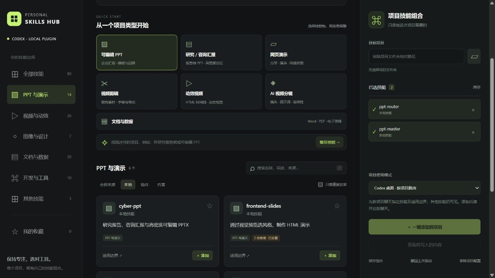

# Personal Skills Hub

**为每个 Codex 项目，选对 skills。**

[English](README.en.md) · [安装与分享](SHARING.md) · [更新记录](CHANGELOG.md) · [贡献指南](CONTRIBUTING.md) · [发布到 GitHub](docs/publishing.md)

[](https://github.com/AndyMaa/personal-skills-hub/actions/workflows/ci.yml)


下载的 skills 越来越多，相近的 PPT、视频、图像工作流也越来越难区分。Personal Skills Hub 将本机技能整理为可搜索的目录，说明适用边界，让你按项目选择组合，并把选用规则交给 Codex。



截图为示例；技能数量和来源取决于你自己的安装情况。

## 能做什么

- **整理技能库**：扫描本地与插件缓存，按用途分类，合并同名本地副本。
- **选择项目组合**：提供 7 套起始技能包，也可逐项选择、收藏和保存组合。
- **减少选型冲突**：展示技能边界，检查已维护的同类制作路线，补齐必要辅助技能。
- **审阅和撤回**：预览将写入的文件，一键应用，支持撤回与移除项目配置。
- **在 Codex 中使用**：安装为个人插件，从插件页面点击“立即试用”，或在聊天中直接调用。

运行时零第三方 npm 依赖。本地面板只监听 `127.0.0.1`。

## 快速开始

需要 **Node.js 22+**。安装为插件时，还需已配置好的 Codex，以及支持 `codex plugin` 的 CLI。

下载并完整解压项目，在目录中运行：

```sh
node src/install.mjs --check
node src/install.mjs
```

Windows 也可双击 **Install Codex Plugin.cmd**。安装完成后重启 Codex，在插件页面找到 **Personal Skills Hub**，点击“立即试用”，发送：

```text
打开 Personal Skills Hub，为当前项目选择需要的 skills。
```

只使用面板可以运行 `npm start`。Windows 还提供 `Open Personal Skills Hub.cmd` 与隐藏窗口启动的 `.vbs` 入口。

默认端口被占用时，使用 `node src/cli.mjs serve --open --port 0` 自动分配端口。收藏与组合保存在当前面板地址的浏览器存储中；不同端口的存储彼此独立。

## 从 GitHub marketplace 安装

仓库自带 `.agents/plugins/marketplace.json`。运行以下命令安装本仓库的插件：

```sh
codex plugin marketplace add AndyMaa/personal-skills-hub
codex plugin add personal-skills-hub@personal-skills-hub
```

本地安装器使用 `personal-skills-hub-local` 市场，GitHub 来源使用 `personal-skills-hub` 市场。使用其中一个来源即可。

## 两种项目模式

| 模式 | 适合什么场景 | 实际行为 |
| --- | --- | --- |
| Codex 桌面路由（默认） | 桌面项目聊天 | 写入技能清单与适用边界；其他技能仍可见，添加后开启新聊天。 |
| 聚焦 CLI | 希望过滤未选业务技能 | 生成专用启动器，通过会话参数限制它启动的 Codex CLI；保留基础技能。 |

**桌面路由不等于技能隔离。** 已测试的 Codex `0.166.0-alpha.5.1` 能读取项目 `skills.config`，但未据此过滤实际技能列表；会话 `-c skills.config=...` 参数有效。聚焦限制只对专用启动器启动的会话生效，详见 [验证记录](VALIDATION.md)。

## 会写入哪些文件

- `AGENTS.md`：Hub 管理区块，包含所选技能及边界。
- `.codex/config.toml`：聚焦模式的项目配置区块。
- `.personal-skills-hub/`：项目清单、历史快照，以及聚焦模式的 CLI 启动器。

Hub 保留管理区块外的现有内容，不修改原技能文件。项目已有手写 skills 配置时，聚焦模式会停止，避免覆盖原规则。撤回会检查文件是否被后续修改；此时可使用“移除项目配置”保留其他编辑。

清单包含本机路径。换电脑时，在新电脑重新扫描并添加组合。

## 技能发现与使用边界

扫描范围包括当前用户的 `.agents/skills`、`.codex/skills` 和 Codex 插件缓存。`CODEX_HOME` 已设置时会跟随该目录。同名本地技能优先使用 `.agents/skills` 中的副本；跨插件同名技能按来源区分。

插件缓存中存在 skill 不代表对应连接器已安装或授权。Hub 管理已有技能，不负责下载第三方技能或提供第三方服务授权。

推荐基于规则，冲突检查覆盖维护过的工作流组。未知技能保留原始描述，不声称能检测任意技能冲突。

## CLI 示例

```sh
node src/cli.mjs scan
node src/cli.mjs recommend "把研究报告做成可编辑 PPTX"
node src/cli.mjs preview --project "项目绝对路径" --preset research
node src/cli.mjs apply --project "项目绝对路径" --skills ppt-router,ppt-master
node src/cli.mjs apply --project "项目绝对路径" --preset motion --mode focused
node src/cli.mjs undo --project "项目绝对路径"
node src/cli.mjs detach --project "项目绝对路径"
```

## 开发与验证

```sh
npm run check
npm test
```

无需 `npm install`。生成分享 ZIP 另需 Python 3.10+：

```sh
npm run package:share
npm run verify:share
```

打包结果在 `dist/`，包括 ZIP、SHA-256 校验文件和打包清单。`verify:share` 可在没有 Codex CLI 的 CI 中验证；要检查实际安装环境，运行 `python -X utf8 scripts/verify_share.py`。

CI 配置覆盖 Windows、macOS、Linux 与 Node.js 22 / 24。本机已验证 Windows；GitHub Actions 的远端结果需推送后确认。

## 文档与许可证

- [分享安装说明](SHARING.md)
- [贡献指南](CONTRIBUTING.md)
- [GitHub 发布步骤](docs/publishing.md)
- [OpenAI 插件打包文档](https://developers.openai.com/plugins/build/plugins)

使用 [MIT License](LICENSE)。分享包只包含 Hub 本身；使用者管理各自的技能库与账号授权。
